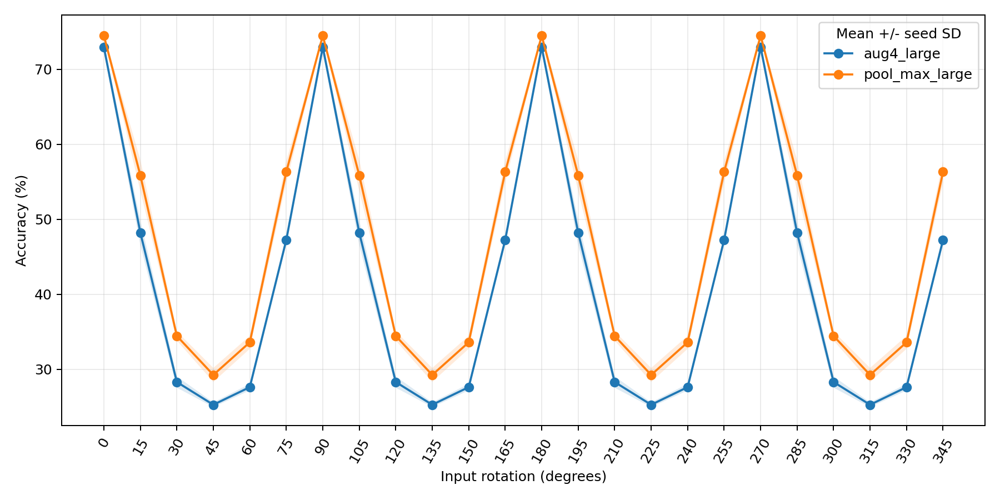

# 更多旋转角度泛化：补充实验

本实验仅评估已有六份冻结权重，不训练，不修改旧结果。已于2026-10-21同步服务器实测汇总，结果见本文末尾。官方测试集此前已经使用，本实验属于事后补充分析，不应称为新的独立盲测。

## 服务器运行

将 `evaluate_angles.py` 放入服务器原来的 `rotation_cifar/`，与 `experiment.py` 同级。使用原项目的 PyTorch/NumPy 环境；绘图额外需要 matplotlib。

```bash
python rotation_cifar/evaluate_angles.py \
  --data 官方测试_2026-10-11/data/official_test.npz \
  --output results/angle_generalization_v2 \
  --batch-size 256 --plot
```

必须把 `--data` 替换为服务器官方测试 NPZ 的真实路径。完整交付包中可省略 `--data`，默认读取项目父目录下的 `官方测试_2026-10-11/data/official_test.npz`。显存不足可减小 batch-size；不需要图可去掉 `--plot`。输出目录必须不存在，防止覆盖；重新运行请使用新的目录名。只在 protocol.json 的 status 为 complete 时使用结果；若绘图失败但状态为 complete，数值文件已完成，图像需另行处理。

## 固定协议

- 权重：aug4_large、pool_max_large，各 seed 1、2、3，80轮的 best.pt。
- 外部输入角度：0～345°，每15°一个，共24个；90°倍数为已见角度，其余20个为未见角度。
- 基线沿用 aggregation_selection.json 中由开发集选出的 mean/geometric 融合，不再选择融合方式。模块仍采用原有四方向特征最大聚合。
- 图像先转成 [0,1] 浮点，再旋转，再按原训练均值/标准差归一化。正角为逆时针，双线性插值、黑色填充、32×32固定画布，不扩图；因此存在边缘裁剪与插值影响。
- 每个角度从原图生成。角度分为小于90°的余角和90°整数倍，余角只插值一次，再精确 rot90；90°倍数直接 rot90。该约定保持 θ 与 θ+90° 的四方向关系。
- 无重新训练、无增加模型内部方向数、无根据测试结果选权重。

## 输出与阅读

| 文件 | 内容 |
|---|---|
| protocol.json | 数据/模型/代码哈希、软件版本、处理约定与完成状态 |
| angle_metrics.csv | 六个模型各角度准确率、宏平均F1；数值使用0～1比例 |
| results.json | 各角度三种子均值/样本标准差，已见/未见平均、各种子最差角度准确率及其汇总 |
| 六份运行名.npz | probabilities[角度,原图,类别]、predictions、labels、ids、angles |
| accuracy_curve.png | 可选曲线，阴影为种子标准差，不是置信区间 |

主要比较为未见角度平均准确率的模块减基线差值。95%区间使用5000次配对重采样：同时采样训练种子与原图，保留每张原图的全部角度关联。只有三个种子，区间应结合逐种子结果解读。24个角度不是24组独立图像。

建议首先核对0°准确率与既有官方测试的 baseline_selected/feature_max 一致（允许设备数值微差），并查看90°倍数结果是否一致；然后阅读未见角度差值和最差角度表现。θ与θ+90°预计接近，不能把它们当成独立泛化证据。结论范围应限定为本次角度网格与图像处理协议，不能扩展为任意连续旋转均有保证。

## 更多旋转角度泛化补充实验（2026-10-21）

在同一官方测试集的10,000张原图上，固定已有六份权重与开发集选择的融合规则，不重新训练，测试0°～345°、间隔15°的24个角度。90°倍数为已见角度，其余20个为未见角度。以下均为三个训练种子的均值；±为样本标准差，差值单位为百分点。

| 指标 | 开发集择优预测融合 | 四方向特征最大聚合 | 提升 |
|---|---:|---:|---:|
| 已见角度平均准确率 | 72.96% ± 0.57 | 74.48% ± 0.26 | +1.52 |
| 未见角度平均准确率 | 35.32% ± 0.52 | 41.88% ± 1.08 | +6.57 |
| 各种子最差角度准确率的均值 | 25.26% ± 0.32 | 29.23% ± 0.93 | +3.98 |
| 全24角度平均准确率 | 41.59% ± 0.50 | 47.32% ± 0.89 | +5.73 |
| 未见角度宏平均F1 | 33.14% | 40.56% | +7.42 |

未见角度平均准确率的三个配对种子收益分别为+6.04、+8.35、+5.30个百分点；报告中的5,000次配对原图与种子bootstrap 95%区间为+5.25～+8.29个百分点，保留同一原图的全部角度关联。全部角度收益区间为+4.56～+7.22个百分点。仅有三个训练种子，区间需结合逐种子结果解读。

| 角度（其余每隔90°重复） | 预测融合准确率 | 特征最大聚合准确率 | 提升（百分点） |
|---|---:|---:|---:|
| 0° | 72.96% | 74.48% | +1.52 |
| 15° | 48.20% | 55.84% | +7.64 |
| 30° | 28.29% | 34.43% | +6.14 |
| 45° | 25.26% | 29.23% | +3.98 |
| 60° | 27.60% | 33.58% | +5.98 |
| 75° | 47.23% | 56.32% | +9.08 |

结论：模块在本次测试的全部未见角度及三个种子上均优于基线，支持其泛化收益超出四种直角旋转；但模块未见角度平均准确率仍仅41.88%，45°为29.23%，不能据此宣称具备充分的任意角度鲁棒性。旋转使用双线性插值、黑色填充、32×32固定画布，会引入边缘裁剪和插值退化，当前实验未将这些因素与方向变化的影响分离。

每个角度从原图生成，先对小于90°的余角插值一次，再精确旋转90°整数倍，随后归一化；模型内部仍只使用原有四方向处理。结果每90°重复，符合两种方法的四方向不变性；24个角度不能视为24组独立样本。这是已使用官方测试集上的事后补充分析，不是新的独立盲测，也不覆盖其他骨干、数据集或真实拍摄分布。

核验范围：144条CSV记录与JSON汇总一致；数据、六份权重及两份代码哈希与本地交付文件一致；六个模型的0°准确率与原官方测试完全一致。当前同步仅含CSV、JSON和曲线，未包含六份逐图预测NPZ，因此未独立重算bootstrap区间，区间按服务器汇总记录引用。




[结果JSON](results/angle_generalization_v1/results.json) · [逐角度CSV](results/angle_generalization_v1/angle_metrics.csv)
