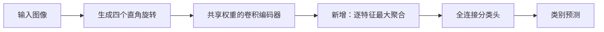

# 推荐课题：基于四方向共享特征聚合的旋转鲁棒图像分类

## 结论

这个题目已有可复现的初步正结果，可以作为课程设计推进。在预先保留的5,000张确认图像上，三个配对随机种子的平均准确率从最强简单预测融合对照的 **73.56%** 提高到 **75.41%**，提升 **1.85个百分点**，三个种子均提高。

难度集中在一个小模块、训练对照与错误分析。使用经典LeNet式CNN及CIFAR-10，无需大模型。单张4090足够；8张卡适合并行做种子和消融。

**创新层级要讲清楚：这是课程中的结构改进与验证。四方向特征最大聚合借鉴已有TI-pooling思想，不声称首次提出该算法。自定义方向评分头没有额外收益，已经删除出推荐方案。**

## 1. 研究问题和基线错误

研究0°、90°、180°、270°方向变化下的自然图像分类。对象类别应当在这些旋转后保持不变，但普通CNN的不同方向预测可能冲突。

先实际训练了随机旋转增强、四方向同时训练、四方向预测平均、几何平均、置信度加权以及加宽CNN。最终采用更强的32/64通道CNN作为主基线，避免只比较极小、训练不足的模型。

该基线在seed1开发集上的单方向预测分歧率为 **32.98%**；467/5,000张图像至少有一个方向分类正确，但四方向平均后仍然判错。这个数量只是诊断，不是可直接部署的“上限模型”。

## 2. 新增模块做什么

在卷积编码器和全连接分类头之间，增加四方向共享特征聚合模块：

设四个方向的特征为 `h_k = E(R_k(x))`，每个特征位置取 `h[j] = max_k h_k[j]`，再由分类器计算 `C(h)`。分类损失直接作用于聚合后的特征，梯度通过被选中的方向响应回传。四个编码分支共享同一组权重。

这改变了特征计算和训练时的梯度路径，能够用卷积、池化、参数共享、数据增强和交叉熵这些课程知识解释。完整枚举四种直角旋转，使输入改变方向时参与聚合的特征集合保持一致。该结论仅对应这四种旋转。

基线与改进模型都是 **256,830个参数**：卷积通道3→32→64、5×5卷积和2×2最大池化，分类头1600→120→84→10。模块没有增加学习参数。两者均编码四个方向；相比只看一个方向的CNN，四方向编码需要额外计算。

## 3. 实验设置

- 数据：CIFAR-10官方训练部分，固定40,000张训练、5,000张开发、5,000张确认。按原图划分后再旋转，检查了旋转轨道重复，未发现跨集合重复。官方test没有解码或评估。
- 数据来源：公开镜像训练文件已固定版本并验证SHA256，详见`manifest.json`。
- 训练：80轮，batch为256张原图，Adam，学习率1e-3余弦下降至1e-5，weight decay 1e-4。全部关键方法使用相同的随机裁剪、水平翻转、原图顺序和初始化种子。
- 强对照：每张原图的四个方向均参与训练，推理时融合四方向预测。额外比较概率平均、几何平均、置信度加权、逆熵加权和最高置信度选择；融合方式只按开发集选择。
- 主指标：原图层面的分类准确率，补充macro-F1、每类召回率、旋转一致性。四种方向不计作四个独立样本。
- 先完成开发集重复实验，固定模型检查点、融合方式和方案，再打开确认集。冻结记录见`confirmation_lock.json`，确认后没有改动训练模型代码。

## 4. 实测结果

主比较均为32/64通道CNN、80轮、三个种子。表内为独立确认集准确率（%）。

| 方法 | seed1 | seed2 | seed3 | 均值 ± 种子标准差 |
|---|---:|---:|---:|---:|
| 四方向训练＋预测概率平均 | 73.14 | 73.30 | 74.08 | 73.51 ± 0.50 |
| 简单预测融合择优：只在开发集选择方式 | 73.14 | 73.46 | 74.08 | 73.56 ± 0.48 |
| 新增四方向特征最大聚合 | **74.70** | **75.90** | **75.62** | **75.41 ± 0.63** |
| 相对简单融合择优的提升（百分点） | **+1.56** | **+2.44** | **+1.54** | **+1.85** |

对照的融合选择依次为概率平均、几何平均、概率平均。没有根据确认集重新选择融合方式。

相对概率平均对照，开发集三种子平均为73.17%→74.99%，确认集为73.51%→75.41%；确认集macro-F1为73.32%→75.25%。相对更强的开发集择优融合对照，确认收益的配对原图与种子bootstrap 95%区间为 **+0.92～+2.85个百分点**。这是当前划分与三个训练种子下的初步证据。

图中的基线为固定概率平均；表格额外给出了更强的开发集择优融合对照。

## 5. 消融和适用边界

80轮、32/64通道、seed1开发集：

| 处理方式 | 准确率 |
|---|---:|
| 四方向训练＋预测平均 | 73.12% |
| 四方向特征平均聚合 | 73.16% |
| 四方向特征最大聚合 | **74.40%** |

这个单种子消融支持保留最大聚合；平均聚合的结果不能代替完整三种子结论。自定义方向评分头在小骨干上没有超过最大聚合，不进入最终方法。

极小CNN在40轮时的优势会在80轮缩小；这也是最终改用更强CNN、统一训练80轮的原因。服饰旋转数据上的改进未通过筛选，不能把当前结果外推到所有数据集。

相对固定概率平均对照，确认集十个类别的平均召回率均提高，提升幅度不同：猫约+4.40、飞机+3.40、卡车+3.13，马约+0.33个百分点。

下面同时保留成功与失败案例，按固定确认顺序取前两个纠错和前两个新增错误，未手动挑选最漂亮的图片。整体提升以全部5,000张图像的统计为准。

当前结论限定于这个CNN及四种直角旋转压力测试；尚未验证任意角度、真实拍摄分布或其他骨干。这里的确认集来自官方训练部分，不是官方测试榜单成绩。

## 6. 论文、代码和课程可讲内容

- 基线依据：[LeCun等，Gradient-Based Learning Applied to Document Recognition，1998](https://bottou.org/papers/lecun-98h)；实现参考[PyTorch官方CIFAR-10分类教程](https://docs.pytorch.org/tutorials/beginner/blitz/cifar10_tutorial.html)。本实验是强化后的LeNet式CNN，不冒充原论文指标复现。
- 模块依据：[Laptev等，TI-pooling，CVPR 2016，论文与作者代码](https://github.com/dlaptev/TI-pooling)。这篇文献是模块来源，实验主基线使用课程级CNN。不能将已有TI-pooling思想描述为自己首次提出。
- 数据依据：[CIFAR-10官方页面和2009年技术报告](https://www.cs.toronto.edu/~kriz/cifar.html)。
- 自己完成的课程工作：错误诊断、模块接入、训练与推理对照、参数量控制、聚合方式消融、三种子重复、独立确认和案例分析。它有明确的结构改动和实测收益，能够支撑课程报告与课堂展示。

代码与运行方法见同目录`README.md`。所有否定实验也保留在上级筛选目录中。
