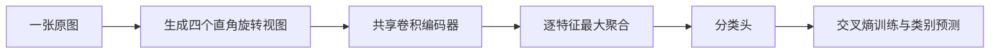

# 旋转鲁棒图像分类项目结构说明

**官方测试更新：**2026 年 10 月 11 日已完成 10,000 张官方测试图像的固定模型评价，准确率为 72.96% → 74.48%，提升 1.52 个百分点。见 [官方测试结果报告](官方测试_2026-10-11/官方测试结果报告.md)。补充数据、代码与逐图预测放在 `官方测试_2026-10-11/`；下文描述原有训练与确认阶段的项目快照，其中“官方测试未使用”是当时状态。

本归档整理当前选定的 CIFAR-10 多方向特征聚合课程项目。实验代码、数据划分、模型权重和结果已从服务器下载，原始项目文件保持原样；新写的开题报告与结构说明放在项目外层，方便修改和提交。

## 先看哪些文件

| 目的 | 入口 |
|---|---|
| 修改或提交开题报告 | [开题报告 Markdown](开题报告/课程设计开题报告.md)；同目录提供可编辑 Word 和 PDF |
| 查当前实验的完整结论与图 | [实验结果说明](实验结果说明.md) |
| 区分最终实验、消融和早期尝试 | [实验结果索引](实验结果索引.md) |
| 看模型与训练实现 | [experiment.py](rotation_cifar/experiment.py) |
| 确认下载是否完整 | [下载校验结果](归档记录/下载校验结果.json)与[文件校验和](归档记录/项目文件SHA256SUMS.txt) |

开题报告按拟研究方案组织，保留具体聚合形式和辅助机制的选择空间。实验结果说明记录已完成的事实，两份材料用途不同。

## 1 归档内容与来源

- 服务器来源：`lab-4090x8-internal:/home/hehaotian/ml-course-newtopic-20261011/rotation_cifar/`。
- 下载日期：2026 年 10 月 11 日。服务器 148 个文件逐一通过 SHA256 校验；仅排除可重新生成的 `__pycache__/`。
- 另从本地原研究目录补入 `data/train.parquet` 与早期 `source_snapshot.json`，来源和校验和记在[本地补充文件清单](归档记录/本地补充文件清单.json)。
- 项目快照共 150 个文件、296,843,695 字节，约 283.09 MiB，含 19 次完成实验、19 份模型权重、31 份预测文件。
- 归档范围为当前 `rotation_cifar` 项目。早期其他课题的筛选摘要放在 `归档记录/早期选题摘要/`，其完整代码和数据仍保留在原研究目录与服务器上。

## 2 目录结构

```text
旋转鲁棒图像分类_项目归档_2026-10-11/
├── 项目结构说明.md                 本文，阅读和使用入口
├── 实验结果说明.md                 已完成实验的解释与图，使用归档内相对链接
├── 实验结果索引.md                 19 次实验的用途、开发集成绩与结果位置
├── 开题报告/
│   ├── 课程设计开题报告.md          可直接修改的文字稿
│   ├── 课程设计开题报告.docx        排版后的可编辑提交稿
│   └── 课程设计开题报告.pdf         固定版式的提交稿
├── rotation_cifar/                 完整项目快照，保留原始文件与目录布局
│   ├── experiment.py              网络、数据加载、增强、训练和开发集评价
│   ├── prepare_hf.py              从固定版本 parquet 生成数据划分
│   ├── evaluate_fixed.py          加载选定权重，生成固定评价与逐图预测
│   ├── aggregate.py               汇总多种子准确率、F1 与配对 bootstrap
│   ├── strong_control_check.py    应用开发集选出的简单融合，核验主收益
│   ├── make_figures.py            生成结果图、分类别图和成功及失败案例
│   ├── manifest.json              原图 ID、来源版本、数据校验和与划分
│   ├── confirmation_lock.json     确认集评价前冻结的方法、种子和代码哈希
│   ├── environment.json           实际训练环境
│   ├── source_snapshot.json       早期快照，不是最终冻结记录
│   ├── baseline_diagnosis.json    早期基线错误诊断
│   ├── large_backbone_error_audit.json  强化骨干的错误诊断
│   ├── README.md                 原服务器运行说明
│   ├── 筛选协议.md                早期方向筛选口径
│   ├── 聚合模块验证协议.md         模块验证与对照约定
│   ├── 选题建议与实验报告.md       原实验报告，保持原件
│   ├── data/
│   │   ├── train.parquet          固定版本的 50,000 张原始训练图像镜像
│   │   ├── train.npz              40,000 张训练原图
│   │   ├── dev.npz                5,000 张开发原图
│   │   └── confirm.npz            5,000 张独立确认原图
│   ├── runs/<mode>_s<seed>_e<epochs>/  每次实验独立保存
│   │   ├── config.json            方法、种子、轮数、参数量和选择指标
│   │   ├── progress.jsonl         每轮损失、开发集表现、累计耗时
│   │   ├── complete.json          训练完成标志、最佳成绩及总耗时
│   │   ├── best.pt                由开发集选定的模型权重
│   │   ├── best_dev_predictions.npz  最佳模型的开发集概率与标签
│   │   ├── fixed_dev*.json / .npz     最终六个模型的固定开发集评价
│   │   └── fixed_confirm*.json / .npz 最终六个模型的确认集评价
│   ├── results/                   三份汇总 JSON，见下文
│   └── figures/                   三张结果图及案例选择记录
└── 归档记录/
    ├── 服务器文件清单.json          每个远端文件的路径、大小、SHA256
    ├── 本地补充文件清单.json        两个本地补充文件的来源
    ├── 下载日志.txt                本次传输记录
    ├── 下载校验结果.json            远端与本地文件核对结果
    ├── 项目文件SHA256SUMS.txt       整个项目快照的校验和
    ├── 数据与实验一致性检查.json    数据、日志、预测与结果的交叉核对
    └── 早期选题摘要/                原服务器上层的两份筛选说明
```

`fixed_dev_predictions.npz` 与 `fixed_confirm_predictions.npz` 是预测文件；`fixed_dev.json` 与 `fixed_confirm.json` 是相应指标文件。基线三次主实验还保存 `aggregation_selection.json`，记录按开发集选定的预测融合方式；个别探索文件仅存在于对应运行目录，完整列表见服务器文件清单。

## 3 代码中的数据流与新增模块

数据由固定训练镜像生成，先按原图分成训练、开发、确认三个集合，再在使用时生成旋转视图。`data/*.npz` 保存 `images`、`labels`、`ids`：图像形状为 `[N, 3, 32, 32]`，像素类型为 `uint8`；`ids` 对应原始镜像中的图像位置。三个集合没有重复 ID，每类分别为 4,000、500、500 张。数据预处理还检查了四方向旋转轨道重复，排除数量为 0。官方测试集没有下载、解码或评估。



`experiment.py` 中的 `orbit()` 生成 0°、90°、180°、270°视图。`LeNet.encoder` 负责共享编码，`LeNet.forward()` 中的 `pool_max` 分支对每个特征维度取四方向最大响应，再送入 `classifier`。模块接在卷积特征和全连接分类头之间；最终网络卷积通道为 3→32→64，特征长度为 1,600，分类头为 1,600→120→84→10。

`aug4_large` 对照也使用四方向训练，并在推理时融合四方向预测。它与 `pool_max_large` 均为 256,830 个参数。模块不增加参数，但相对单视图 CNN 需要四次编码；不能把共享参数等同于没有额外计算。

## 4 最终实验与历史模式

| 模式 | 当前角色 | 解释 |
|---|---|---|
| `aug4_large` | 主对照，seed 1–3、80 轮 | 32/64 通道 CNN，四方向训练，预测层融合 |
| `pool_max_large` | 当前保留模块，seed 1–3、80 轮 | 同骨干，四方向特征逐维最大聚合 |
| `pool_mean_large` | 单种子消融，seed 1、80 轮 | 把最大聚合换成平均聚合 |
| `plain`、`aug` | 早期基线 | 普通训练、随机直角旋转增强 |
| `aug4`、`aug4_wide` | 早期训练及容量对照 | 较小骨干与加宽骨干的四方向训练 |
| `pool_max`、`pool_mean` | 早期模块探索 | 较小骨干的最大与平均聚合 |
| `canon_soft`、`canon_hard`、`canon_aux_tta` | 未纳入最终方案的探索 | 方向评分、软/硬选择及辅助任务对照 |

主结果来自下面三份文件：

| 文件 | 用途 |
|---|---|
| `results/dev_pool_max_large_vs_aug4_large.json` | 开发集三种子比较，用于方法筛选 |
| `results/confirm_pool_max_large_vs_aug4_large.json` | 确认集与固定概率平均对照的比较 |
| `results/strong_control_confirmation.json` | 确认集与开发集择优简单融合的比较，主收益依据 |

最强简单对照的确认集平均准确率为 73.56%，特征最大聚合为 75.41%，平均提升 1.85 个百分点。三个配对种子均为正，配对原图与种子 bootstrap 的 95% 区间为 +0.92～+2.85 个百分点。详细逐种子结果和边界见实验结果说明。

## 5 如何使用这份归档

### 直接阅读结果

不训练、不安装 CUDA，也能打开所有 Markdown、JSON 和 PNG。模型权重在 `runs/*/best.pt`，数据和预测在 NPZ 文件中，可用 NumPy 读取：

```python
from pathlib import Path
import numpy as np

project = Path("rotation_cifar")  # 从归档根目录运行
data = np.load(project / "data/dev.npz", allow_pickle=False)
print(data["images"].shape, data["labels"].shape, data["ids"].shape)
```

逐图预测的 `probabilities` 形状为 `[4, N, 10]`。普通网络保存四个单方向预测；特征聚合模型保存融合后预测的四份重复值，不能将它们计为四个独立样本。固定评价文件还保存原图 ID，方便配对核对。

### 复用现有实验环境

实际环境为 Linux、Python 3.10.19、PyTorch 2.5.1+cu121、NumPy 1.26.4，使用 RTX 4090。训练和固定评价代码直接使用 CUDA，不能在没有 NVIDIA CUDA 的本地 Mac 上原样训练。单张 24 GB 卡即可运行，多卡可用于独立种子实验。环境借用路径只在原服务器上有效：

```bash
cd /home/hehaotian/ml-course-newtopic-20261011/rotation_cifar
COURSE_PY=/home/hehaotian/ml-course-patchcore/.venv/bin/python
```

已有数据可直接使用，无需再运行 `prepare_hf.py`。新环境依赖与从头准备数据的方法见项目原 `README.md`；预处理额外需要 Pillow、PyArrow，绘图需要 Matplotlib。归档提供实际版本记录，没有把环境目录复制进来。

### 新实验与复核

为了保留归档，训练和会写入结果的评价请在工作副本中运行。训练输出按“方法、种子、轮数”命名，禁止覆盖同名目录；主实验 seed 1–3 已存在，新增配对实验可用 seed 4：

```bash
# 在独立工作副本的 rotation_cifar 目录中运行，并选择空闲 GPU
CUDA_VISIBLE_DEVICES=0 python experiment.py --mode aug4_large --seed 4 --epochs 80
CUDA_VISIBLE_DEVICES=0 python experiment.py --mode pool_max_large --seed 4 --epochs 80
```

只复核已有模型时，可在工作副本运行以下命令；它会重写该副本中的固定开发集评价文件：

```bash
CUDA_VISIBLE_DEVICES=0 python evaluate_fixed.py --run pool_max_large_s1_e80 --split dev
```

`aggregate.py`、`strong_control_check.py` 使用保存的逐图预测重新汇总，不重新训练；它们仍会导入 `experiment.py`，环境需要 PyTorch。确认集评价脚本检查运行名是否在冻结清单中；归档时另外核验了冻结记录中的代码哈希。已有确认结果不应再用于反复挑选更好的方案。

### 检查文件完整性

从归档根目录运行：

```bash
# macOS
shasum -a 256 -c 归档记录/项目文件SHA256SUMS.txt

# Linux
sha256sum -c 归档记录/项目文件SHA256SUMS.txt
```

本次整理已检查：148 个远端文件的字节和哈希一致；两个本地补充文件一致；数据形状和划分 ID 正确；19 次日志轮数完整；31 份预测概率、标签与 ID 一致；固定评价的准确率和宏平均 F1 可从预测复算，主对照的逐种子收益与汇总一致。此次整理没有重新训练或改动原模型实现。

## 6 报告中的表述边界

课程改进的核心是模块接入、错误诊断和受控验证，特征聚合思路参考已有 TI-pooling 工作。结论限定在本次 CNN、CIFAR-10 训练部分划分和四种直角旋转条件下，不代表任意角度或真实拍摄分布的结果。预测平均对照本身也具备四方向不变性，因此模块优于对照的证据应来自分类表现，不能仅靠“不变性”说明优势。

原始项目中的实验报告保留了制作时的绝对图片路径；归档外层的 `实验结果说明.md` 已改用相对路径，移动或解压整个归档后仍可查看图片。训练、评价与绘图脚本按脚本所在目录定位数据和输出，搬运时保留整个 `rotation_cifar` 布局即可。早期 `source_snapshot.json` 中的模型哈希对应历史版本，最终冻结核对以 `confirmation_lock.json` 为准。
